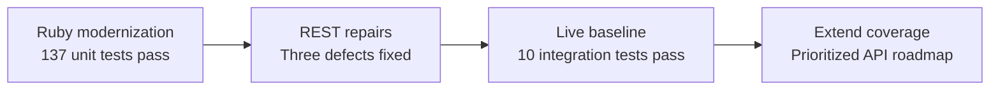

# Parse Stack compatibility findings

Recorded: 2026-11-07. Covers the Ruby modernization and REST compatibility changes for 2.0.0.

## Result

The SDK now targets **Ruby 3.0 or later**. All three confirmed REST defects are fixed. Selected end-to-end checks pass against **Parse Server 9.10.7 / MongoDB 8.0.17**, on Ruby 3.0.7 and 4.0.2. This is a tested baseline, not complete certification of every endpoint or deployment.

## Reports

| Report | Contents |
| --- | --- |
| [Ruby compatibility](ruby-compatibility.md) | Runtime fixes, dependencies, migration impact, CI. |
| [REST compatibility](rest-api-compatibility.md) | Original defects, repairs, helper coverage, limits. |
| [Validation evidence](compatibility-validation.md) | Runtime matrix, live checks, commands, unverified areas. |
| [REST support plan](rest-api-support.md) | Examples, remaining helpers, priorities, extension process. |
| [Integration harness guide](test/integration/README.md) | Local/CI commands, test layers, lifecycle, scenarios, and expansion design. |

## Findings and disposition

| Finding | Current status |
| --- | --- |
| Ruby block capture and keyword forwarding failures | Fixed across queries, scopes, associations, authentication, requests, and callbacks. |
| Advanced parameters became field filters | Fixed; known options are top-level parameters. Explicit `server_options` supports future options. |
| Job-status header discarded | Fixed; response headers are retained and `Parse.trigger_job` returns the tracking ID. |
| Installation header lacked `X-` | Fixed; signup/login accept `installation_id:`. Live session pairing passed. |
| Batch default differed from guide | Changed from 50 to configurable 20. Contracts verify 21 operations split into 20 + 1. Live custom-mount requests pass. |
| Projection acceptance unknown | Comma-delimited and JSON-array keys both passed on the pinned server. |
| Missing deletion/impersonation helpers | Added file deletion, schema deletion, and user impersonation; contract and live checks pass. |
| Missing pipeline helper | Added `aggregate_pipeline`; live grouping/summing passed. |
| Future API access | Generic requests retain body, query, headers, and options, including query parameters on POST. |

## Validation and remaining work

- Unit suite: **137 tests, 875 assertions**, zero failures/errors/skips, on Ruby 3.0.7, 3.2.10, 3.3.10, 3.4.1, and 4.0.2.
- ActiveModel 8.1.4.1: the same suite passes on Ruby 3.4.1 and 4.0.2.
- Live suite: **10 tests, 57 assertions**, zero failures/errors/skips, on Ruby 3.0.7 and 4.0.2.
- Ruby 3.1 remains unverified locally: the installed interpreter lacks its socket extension. CI includes it.
- Unit, newer-dependency, and integration CI jobs are configured; remote results are unknown.
- Other server versions, PostgreSQL, external file adapters, push delivery, and exhaustive permissions/query behavior require separate checks. The deployed server/database target has not been supplied.

The original 95-test suite now has 42 additional unit tests. Integration tests are separate and opt-in. See the support plan for remaining work.

## Publication

Version is `2.0.0`, prepared on branch `ruby-3-rest-compatibility`. The major version reflects Ruby 2.x removal and dependency-major changes. No push or publication has been performed. Review remote CI and the Ruby/dependency migration before publishing.
