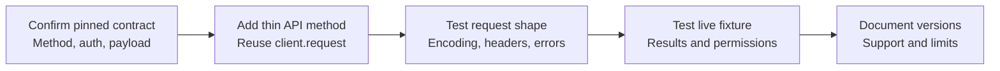

# REST API support and extension plan

Recorded: 2026-11-07. Implemented support and proposed follow-up work; no release dates are promised.

Related: [findings](compatibility-findings.md), [REST review](rest-api-compatibility.md), [validation](compatibility-validation.md).

For harness architecture, run commands, scenario design, and the planned version/database matrix, see the [integration harness guide](test/integration/README.md).

## Available now

```ruby
query = Parse::Query.new('Song', :score.gte => 10,
  read_preference: :primary, exclude_keys: [:private_value], limit: 20)
rows = query.results

# Explicit extension point for newer REST query parameters.
# The server must support the option being forwarded.
query.server_options(hint: { score: 1 })
query.server_options(readPreference: nil) # Remove one option.
query.clear(:server_options)             # Remove additional options.

# An object field with an option's name remains accessible explicitly.
Parse::Query.new('Song', :read_preference.eq => 'field-value')

user = Parse::User.login('name', 'password', installation_id: 'installation-uuid')
impersonated_user = Parse::User.login_as(user.id) # Master key required.

job_id = Parse.trigger_job('dailyReport')
response = Parse.trigger_job('dailyReport', {}, raw: true)
response.job_status_id
response.header('X-Parse-Job-Status-Id')

client = Parse::Client.client
client.delete_file('server-assigned-name.bin')
client.delete_schema('EmptyClass')
client.aggregate_pipeline('Song', [
  { '$group' => { '_id' => nil, 'total' => { '$sum' => '$score' } } }
])
client.batch_size = 20
```

`server_options` recognizes Ruby and REST spellings for read preferences and exclusion, plus `hint` and `explain`. Unknown constructor conditions remain field filters. Unknown **explicit** server option names pass unchanged. Hashes/arrays are JSON-encoded; `excludeKeys` uses the accepted comma format. Read preferences are validated. Set core clauses such as `where`, `keys`, `limit`, and `order` through their normal query methods.

Values are copied to protect caller data. Changing options clears cached results. The live baseline exercises `PRIMARY` and exclusion. Hint forwarding has contract coverage; explain is recognized but lacks a dedicated test. Neither has live behavior coverage here, and replica routing is unverified. A forwarded option does not guarantee that a server or database adapter supports it.

## Use an endpoint before a helper exists

`client.request` accepts a relative path, body, query, headers, and normal request options. It returns `Parse::Response` with error/status/header metadata. For example, restricted-session installation pairing can be expressed as:

```ruby
response = client.request(:put, 'sessions/me',
  body: { installationId: 'installation-uuid' },
  opts: { session_token: restricted_session_token, use_master_key: false })
```

This extension example has not been live-tested here. See the [pairing contract](https://docs.parseplatform.org/rest/guide/#pairing-session-with-installation). Non-GET query parameters are retained, as verified by impersonation. Normal paths are relative to `server_url`; manually constructed **batch** paths include its mount prefix.

## Prioritized follow-up

| Priority | Area and current state | Required work and acceptance check |
| --- | --- | --- |
| 1 | Deployment coverage: only 9.10.7/MongoDB 8.0.17 is live-tested. | Add the deployed server/database target when identified. Test the oldest supported and current target versions; record adapter differences. |
| 1 | Sessions: dedicated current-session fetch; generic session/object access exists. | Add create/list/update/delete/pair helpers as needed. Test restricted sessions, permitted/denied pairing, client-key behavior, revocation, and invalid tokens. |
| 1 | Indexes and CLPs: schema methods already accept raw payloads. | Add examples/builders and live index add/drop plus public/authenticated/master permission tests. These are not inaccessible endpoints. |
| 2 | Roles/installations/pointers/relations: existing models, routes, and constraints. | Broaden live membership, relation add/remove/query, installation CRUD, and permission tests before adding wrappers. |
| 2 | Config: basic get/update exists; update wraps only `params`. | Check the pinned server contract, then add newer metadata such as master-only flags. Test public/master views and cache refresh. |
| 2 | Advanced queries: new options pass through; operators mostly unit-tested. | Add live hint/explain, replica preferences, text/geo/relational cases, and adapter-specific expectations. |
| 2 | Authentication/email: user methods cover some workflows. | Identify required provider/server versions. Add missing helpers and sandbox mail/provider adapters. Test session identity, rejection, reset, and verification. |
| 3 | Hooks/analytics/push: routes already exist. | Test with local webhooks and fake push adapters. Check payload/auth; distinguish server acceptance from device delivery. |
| Separate scope | LiveQuery and GraphQL | Implement separate protocol clients if requested. REST forwarding does not implement subscriptions or GraphQL behavior. |

Reference contracts: [sessions](https://docs.parseplatform.org/rest/guide/#sessions), [schema/index changes](https://docs.parseplatform.org/rest/guide/#modifying-the-schema). The table distinguishes missing convenience methods from existing generic access and missing validation.

## Add a feature



1. Check the guide and each supported server's source. Record version, database, adapter, and auth requirements. Do not infer compatibility only from upstream `master`.
2. Add a small method in `lib/parse/api/` that delegates to `request`. Preserve `headers:` and `**opts`; use explicit blocks/keywords for Ruby 3. Add a model wrapper only when useful.
3. Add independent request contracts in `test/lib/parse/`, including errors/permissions where relevant. Do not silently drop unsupported options or automatically retry a write after a version error.
4. Add disposable-server tests in `test/integration/`. Use local adapters for external effects. Run the unit matrix and oldest/newest Ruby integration lanes.
5. Update the reports, README, and changelog with exact tested versions. Mark a feature verified only after its live cases pass.

The fixture pins npm dependencies and MongoDB for repeatable checks. Upgrade these pins deliberately, run both suites, and update CI/baseline documentation. `client.server_version` can inform capability checks, but a version comparison does not replace behavior tests or adapter checks.

## Release work

Version 2.0.0 is prepared on branch `ruby-3-rest-compatibility`. Verify remote CI and the deployed target; review Ruby 2.x removal and Faraday 2/Rack 3 migration before publishing. No push or publication has been performed.
