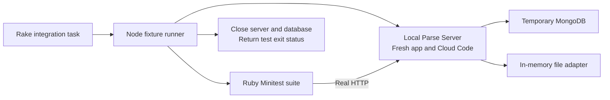

# Integration test harness

The harness tests the Ruby SDK against a real, disposable Parse Server and MongoDB. It runs locally or in CI. It does not need Docker, a deployed app, or production credentials.

Related: [validation evidence](../../compatibility-validation.md), [API support plan](../../rest-api-support.md), [CI jobs](../../.github/workflows/ruby.yml).

## Architecture



Each run creates random app credentials, a fresh database, and an unused loopback port. Each test uses unique object/class names. The custom `/sdk/parse` mount catches assumptions about the default URL path. The runner starts Parse Server before the Ruby tests and performs cleanup in `finally`.

The database is a real `mongod` process, managed by `mongodb-memory-server-core`; HTTP and database operations are not mocked. Files use a local adapter backed by a Map. Cloud Functions and jobs run fixture Cloud Code.

## Run it

From the repository root, select Ruby 3.0 or later and Node 24.11.0, then run:

```sh
gem install bundler -v 2.5.23
bundle _2.5.23_ install
npm ci --prefix test/integration --no-audit --no-fund
bundle _2.5.23_ exec rake integration
```

The npm fixture accepts compatible Node 24 releases; CI pins 24.11.0. Node and MongoDB are test dependencies, not Ruby SDK runtime dependencies. The first run downloads MongoDB and requires network access. Later runs reuse the binary cache.

To select a Node executable explicitly:

```sh
NODE=/absolute/path/to/node bundle _2.5.23_ exec rake integration
```

The Rake task selects the same Ruby interpreter that runs Rake. The runner does not accept an external server URL. Its generated connection variables are passed to the child test process. Run through Rake rather than invoking the Ruby integration file directly.

## Current evidence

Recorded 2026-11-07:

| Component | Tested version |
| --- | --- |
| Ruby | 3.0.7 and 4.0.2 |
| Parse Server | 9.10.7 |
| MongoDB | 8.0.17, standalone |
| Node | 24.11.0 |
| Result | 10 tests, 57 assertions; zero failures, errors, or skips on each Ruby |

These are completed local runs, including cleanup. GitHub Actions integration jobs are configured for Ruby 3.0 and 4.0 on Ubuntu; remote results have not been verified. Version pins are in [package.json](package.json), [package-lock.json](package-lock.json), and [run.js](run.js).

The ten cases cover CRUD/errors, typed values/atomic operations, queries/projections, aggregation, batches/custom mount, users/sessions/installation pairing/impersonation, a private-object ACL, binary file upload/deletion, schemas, and functions/job tracking.

## Test layers

| Layer | Command | Purpose |
| --- | --- | --- |
| Unit and request contracts | `bundle exec rake test` | Check Ruby behavior and exact methods, paths, query/body encoding, headers, and error handling. Uses controlled HTTP responses. |
| Live integration | `bundle exec rake integration` | Check SDK behavior against the pinned server and real database. |
| Deployment combinations | Planned extension | Run the same scenarios against each supported server/database combination. This is not implemented by passing an environment variable today. |

Both existing layers are needed. A live test can show that a batch succeeds; a request contract independently checks that its size is 20 + 1. A successful master-key request does not prove that public or user credentials have the correct access.

## Add a scenario

1. Add a test to [rest_api_test.rb](rest_api_test.rb). Use `@client` or a public SDK/model method. Add fixture Cloud Code to [cloud.js](cloud.js) only when the feature requires it.
2. Create data inside the test. Use the unique `@table` or random names, and assert setup success. Do not depend on test order, existing accounts, or fixed object IDs.
3. Assert meaningful results: stored values, returned identity, side effects, or expected Parse errors. For auth-sensitive features, test allowed and denied requests separately. Use a client without a master key for the denied case.
4. Add a request contract in `test/lib/parse/` when the new behavior depends on an HTTP shape or header. A live success alone may miss incorrect serialization accepted by one server.
5. Run both commands and update the support/validation reports with the exact tested combination. Keep untested adapters and versions marked unverified.

For background work, poll observable state until completion with a bounded deadline. The current job test polls `_JobStatus`; avoid relying on one arbitrary sleep. Database query tests should use fixed values and explicit ordering where order is asserted.

## Extend the harness

The following items are proposed, not implemented:

| Order | Extension | Design and acceptance check |
| --- | --- | --- |
| 1 | Stronger lifecycle control | Add startup/overall timeouts, SIGINT/SIGTERM cleanup, and child termination escalation. Verify failed startup, interrupted runs, and a stuck child leave no owned processes. Current timeout covers only the Ruby child; forced termination is not fully handled. |
| 2 | Permissions and relation coverage | Add CLPs, role membership, pointers/relations, restricted sessions, and config tests with public/user/master credentials. Check both accepted and rejected requests. |
| 3 | Supported version matrix | Select named, pinned fixture profiles. Each profile owns a package lock, compatible Node version, database version, and explicit expected capabilities. Keep the baseline profile while adding the deployed target. Do not silently install `latest` during PR checks. |
| 4 | PostgreSQL adapter lane | Provision disposable PostgreSQL/PostGIS in CI, add a database lifecycle abstraction, and run shared cases. Record documented adapter differences explicitly; do not silently skip an unexpected failure. |
| 5 | Replica-set lane | Use a disposable MongoDB replica set for secondary-read and transaction scenarios. Standalone MongoDB cannot establish replica routing behavior. |
| 6 | External-service adapters | Add local webhook listeners and fake mail/push/file adapters that record calls. Assert recipients, payloads, headers, and errors. Run real-provider checks separately with dedicated test accounts. |
| 7 | Failure artifacts | Write a version manifest, test report, and server log to a run-owned output folder. Upload artifacts on CI failure; exclude tokens/passwords from logs. Currently output is console text, not a structured artifact bundle. |

Suggested CI policy: keep the pinned baseline on every PR; add the deployed/oldest supported combination once identified. Use a scheduled broader matrix to detect upstream drift. Require passing unit and applicable integration jobs before merging. Branch protection and scheduled jobs are not configured by this guide.

## Troubleshooting and limits

- Check Ruby and Node versions first. The first database download can fail due to network access or an unavailable OS/architecture build.
- The cache defaults to `parse-stack-mongodb-binaries` under the OS temp directory. `MONGOMS_DOWNLOAD_DIR` can select another writable cache.
- Expected negative tests log errors such as object-not-found or invalid-session-token. Use the test summary and command exit status to identify failures.
- An exit code of zero means the suite and normal cleanup completed. Startup, assertion, or cleanup errors produce a nonzero exit.
- Normal cleanup is implemented. Signal interruption, process crashes, and failed/partial server startup need the lifecycle hardening described above.
- Other server versions, PostgreSQL, replica routing, production file storage, actual mail/push delivery, and exhaustive permissions/operators are not certified by this baseline.

The lifecycle pattern follows the upstream [MongoDB test-server guide](https://typegoose.github.io/mongodb-memory-server/docs/guides/quick-start-guide/). For additional database profiles, check the pinned Parse Server release's compatibility requirements against the [Parse Server project documentation](https://github.com/parse-community/parse-server).
